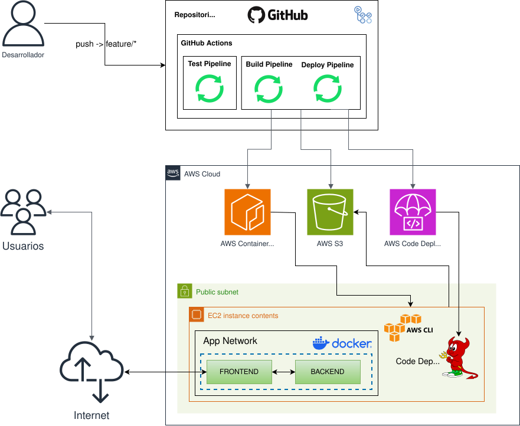
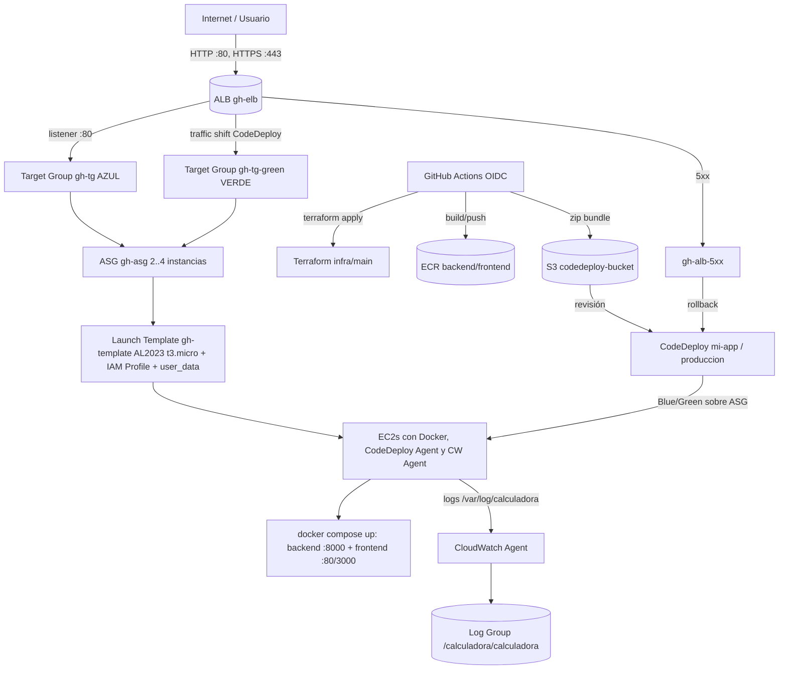

# Calculadora FullStack en AWS — Terraform, Blue/Green y Observabilidad

Repositorio de práctica DevOps que aprovisiona en **AWS**, mediante **Infraestructura como Código (Terraform)**, una aplicación _FullStack_ (**React + Nginx / FastAPI**) lista para producción, con **despliegue Blue/Green**, **rollback automático** y **observabilidad con CloudWatch**.



---

## 1. Propósito del proyecto

Este proyecto no busca solo “subir una app a EC2”. Su propósito es demostrar, de forma reproducible y automatizable, el **ciclo completo de vida de una aplicación en la nube**:

1. **Aprovisionar infraestructura** (red, cómputo, balanceo, registro, despliegue, observabilidad) sin tocar la consola.
2. **Construir y publicar imágenes** de _backend_ y _frontend_ en un registro privado.
3. **Desplegar con Blue/Green** sin tiempo fuera de servicio, con control de tráfico.
4. **Hacerse reversible en segundos**: si el despliegue produce errores, se revierte automáticamente.
5. **Observar todo**: métricas, logs, alarmas y dashboard en CloudWatch, sin instalar nada a mano en cada instancia.
6. **Automatizar CI/CD con GitHub Actions + OIDC**: sin claves estáticas de AWS en el repositorio.

### Objetivos pedagógicos / funcionales

| Objetivo            | Cómo se cumple                                                                                        |
| ------------------- | ----------------------------------------------------------------------------------------------------- |
| Alta disponibilidad | VPC multi-AZ, ALB y ASG con mínimo 2 instancias                                                       |
| Seguridad           | SGs de mínimo privilegio, IAM con menor privilegio, SSM sin SSH abierto, OIDC sin `AWS_ACCESS_KEY_ID` |
| Despliegues seguros | CodeDeploy **Blue/Green + `WITH_TRAFFIC_CONTROL`** sobre ASG                                          |
| Rollback automático | Alarma CloudWatch `gh-alb-5xx` registrada en el Deployment Group                                      |
| Observabilidad      | Agent en cada EC2, logs centralizados, 5 alarmas, dashboard                                           |
| Trazabilidad        | Imágenes con tag = _short-hash_ de git + `latest`, bundles versionados en S3                          |
| Economía            | `terraform destroy` limpio; workflows con pausa y destrucción opcional                                |

> **Regla de oro de la arquitectura:** el tráfico público **solo** entra por el **ALB**. Las instancias EC2 jamás escuchan directamente en Internet. El path es `Internet → ALB (80/443) → EC2 (80, desde SG del ALB) → Nginx → Backend`.

---

## 2. Stack tecnológico

| Capa                      | Tecnología / Servicio                                                              |
| ------------------------- | ---------------------------------------------------------------------------------- |
| **Backend**               | Python 3.9 + FastAPI + Uvicorn (imagen `python:3.9-alpine`, usuario no-root)       |
| **Frontend**              | React + TypeScript + Nginx _unprivileged_ 1.27 (multi-stage: build Node 18)        |
| **Contenedores**          | Docker + Docker Compose (orquesta `backend` + `frontend` en EC2)                   |
| **IaC**                   | Terraform >= 1.0 (CI usa `1.10.3`), provider AWS ~> 5.0, provider `random` ~> 3.0  |
| **Cómputo**               | EC2 Amazon Linux 2023 (`t3.micro`) + Launch Template + Auto Scaling Group          |
| **Red / Balanceo**        | VPC, 2 subnets públicas, IGW, ALB (HTTP:80) + Target Groups azul/verde             |
| **Registro / Artefactos** | ECR (2 repos, _scan on push_), S3 (bundles CodeDeploy, versionado + AES256)        |
| **Despliegue**            | AWS CodeDeploy (Blue/Green, ASG + ALB) + agente en cada EC2                        |
| **Observabilidad**        | CloudWatch Agent + Logs + Metric Alarms + Dashboard, config en SSM Parameter Store |
| **CI/CD**                 | GitHub Actions + OIDC federado (`aws-actions/configure-aws-credentials@v4`)        |
| **State remoto**          | S3 Backend (`use_lockfile` nativo) — ver §4.1                                      |

---

## 3. Arquitectura de la solución — visión general



### Flujo Blue/Green (resumen)

1. CodeDeploy crea una **flota verde** copiando el ASG (`COPY_AUTO_SCALING_GROUP`).
2. En la flota verde instala la revisión desde S3 y levanta los contenedores nuevos.
3. Valida el servicio (`/api/health` → 200).
4. Mueve **todo el tráfico** del ALB del grupo azul al verde.
5. Si todo va bien: termina las instancias azules (5 min de gracia).
6. Si hay error 5xx (alarma) o fallo: **rollback automático** a la flota azul.

---

## 4. Infraestructura en detalle

La infraestructura se compone de **dos módulos Terraform independientes**:

```
infra/
├── bootstrap/       # 1) Lo que se crea una vez: estado remoto + OIDC GitHub
└── main/            # 2) La app en sí: VPC, ALB, ASG, ECR, S3, CodeDeploy, CloudWatch
```

### 4.1 `infra/bootstrap` — pre-requisitos para todo lo demás

Se aplica **una sola vez** (estado local). Crea:

| Recurso                                                                                                                    | Para qué                                                                                                                                      |
| -------------------------------------------------------------------------------------------------------------------------- | --------------------------------------------------------------------------------------------------------------------------------------------- |
| Bucket S3 `infraestructura-calculadora-terraform-state` (versionado, AES256, sin acceso público, política que exige HTTPS) | Guarda el `terraform.tfstate` de `infra/main`                                                                                                 |
| Tabla DynamoDB `calculadora-terraform-locks` (`PAY_PER_REQUEST`)                                                           | _Distributed locking_ del state (ver nota sobre `use_lockfile` abajo)                                                                         |
| OIDC Provider `token.actions.githubusercontent.com` (reutilizable vía `create_oidc_provider = false`)                      | Identidad federada GitHub → AWS                                                                                                               |
| Rol IAM `GitHubActionsMainDeployRole`                                                                                      | Asumible solo vía OIDC con _subject claims_ acotados (repo/rama)                                                                              |
| Políticas                                                                                                                  | `terraform_state_access` (S3+DynamoDB), `main_infra_provisioning` (EC2/ELB/ASG/ECR/S3/CodeDeploy/CloudWatch/IAM acotado/SSM `/calculadora/*`) |

> **Nota:** `infra/main/main.tf` hoy declara `backend "s3" { use_lockfile = true }` (lock nativo de S3, sin DynamoDB). El `backend_config_snippet` que emite `bootstrap/outputs.tf` es legacy con `dynamodb_table`. El comportamiento efectivo es: el lock lo hace S3; la tabla existe como respaldo/compatibilidad.

**Variables clave de bootstrap** (`infra/bootstrap/variables.tf`): `aws_region`, `project_name`, `environment`, `state_bucket_name`, `create_oidc_provider`, `github_repository`, `github_branch`, `github_subject_claims`, `role_name`, `attach_admin_policy` (solo para talleres).

**Outputs clave:** `state_bucket_name/arn`, `dynamodb_table_name/arn`, `github_oidc_provider_arn`, `github_actions_role_arn` (→ variable GitHub `AWS_ROLE_ARN`), `backend_config_snippet`.

### 4.2 `infra/main` — la infraestructura de la aplicación

Todo vive en `infra/main/` y se carga como **un solo módulo** (`main.tf` + `observability.tf` + `variables.tf` + `outputs.tf` + `user_data.sh`).

#### 4.2.1 Red (VPC multi-AZ)

- VPC `10.0.0.0/16` con DNS activado.
- 2 subnets públicas: `10.0.1.0/24`, `10.0.2.0/24` en 2 AZs distintas (imprescindible para ALB HA).
- IGW + tabla de rutas `0.0.0.0/0 → IGW`.
- AMI resuelta por data source: la más reciente **Amazon Linux 2023 x86_64 HVM** (nada hardcodeado).

#### 4.2.2 Security Groups (mínimo privilegio)

| SG                                   | Entrada                                                                                                            | Salida                        |
| ------------------------------------ | ------------------------------------------------------------------------------------------------------------------ | ----------------------------- |
| `gh-security-group-elb` (ALB)        | 80 y 443 desde `0.0.0.0/0`                                                                                         | Todo (hacia instancias)       |
| `gh-security-group-ec2` (instancias) | **Solo** `var.app_port` (80) **desde el SG del ALB**; SSH opcional vía `var.allowed_ssh_cidrs` (por defecto vacío) | Todo (pull ECR, S3, AWS APIs) |

> Administrarse vía **SSM Session Manager**; el puerto 22 está cerrado por defecto.

#### 4.2.3 IAM para las instancias (`calculadora-ec2-app-role`)

El perfil de cada EC2 hereda:

- `AmazonSSMManagedInstanceCore` (SSM).
- `CloudWatchAgentServerPolicy` (publicar métricas/logs).
- Política propia de lectura de S3 (solo el bucket de CodeDeploy).
- Política propia de pull ECR (solo los 2 repos).
- Política propia `ssm:GetParameter` **acotada al ARN exacto** del parámetro de config de CloudWatch Agent.

#### 4.2.4 ALB + Target Groups (Blue/Green)

- ALB `gh-elb` (público, `application`), subnets públicas, SG de ALB.
- Listener HTTP `:80` → TG **azul** `gh-tg` (con `ignore_changes` en `default_action` para que CodeDeploy lo mueva).
- TG **verde** `gh-tg-green` (mismo puerto/protocolo, health check idéntico).
- Health check: `GET /api/health` → 200, cada 30 s, timeout 5 s, 2 sanos / 3 enfermos.
- `deregistration_delay = 30 s` (variable) para drenado rápido.

#### 4.2.5 Cómputo — Launch Template + ASG

- Launch Template `gh-template` (AL2023, `t3.micro`, SG de instancias, IAM profile, `user_data` codificado).
- ASG `gh-asg`: `min = 2, desired = 2, max = 4`, `health_check_type = "ELB"` (si falla el health del ALB, reemplaza), `health_check_grace_period = 300 s`, tags propagados.
- **¿Por qué ELB y no EC2?** Con `EC2`, una instancia cuya app murió se seguiría considerando “sana”. Con `ELB`, el ASG la sustituye.

#### 4.2.6 `user_data.sh` — cómo nace cada instancia

Procesado con `templatefile()` (inyecta `aws_region`, `cw_agent_ssm_param`, `app_log_file_path`). Instala, en este orden:

1. `dnf update`, Docker, Ruby (requerido por CodeDeploy), `wget`, `unzip`.
2. AWS CLI v2 si falta.
3. Servicio Docker + **Docker Compose v2** (binario + symlinks).
4. **Directorio de logs** `/var/log/calculadora/calculadora.log` con permisos `777/666` (el directorio lo crea Docker como volumen root; backend y frontend escriben el mismo archivo con `tee`).
5. **CodeDeploy Agent** (instalador específico de la región).
6. `/opt/mi-app` de `ec2-user`.
7. **CloudWatch Agent** + `fetch-config -c ssm:/calculadora/cloudwatch-agent/config` (al final a propósito: con `set -e`, un fallo de observabilidad no debe impedir que la instancia quede lista para CodeDeploy).

#### 4.2.7 ECR + S3

| Servicio                                          | Detalle                                                                                         |
| ------------------------------------------------- | ----------------------------------------------------------------------------------------------- |
| ECR `calculadora/backend`, `calculadora/frontend` | `MUTABLE`, `scan_on_push = true`, `force_delete` para `destroy` limpio                          |
| S3 `calculadora-codedeploy-bucket-<random>`       | Versionado + AES256 + `force_destroy` (práctica). IAM de instancia con acceso de lectura mínimo |

#### 4.2.8 CodeDeploy — Blue/Green sobre ASG + rollback

- App `mi-app` (Server, `compute_platform = "Server"`).
- Grupo `produccion`: `CodeDeployDefault.OneAtATime`, `autoscaling_groups = [gh-asg]`, `deployment_style = BLUE_GREEN + WITH_TRAFFIC_CONTROL`, `green_fleet_provisioning = COPY_AUTO_SCALING_GROUP`, `terminate_blue = TERMINATE (5 min)`, `action_on_timeout = CONTINUE_DEPLOYMENT`.
- Rol `codedeploy-service-role`: `AWSCodeDeployRole` + política propia `ec2:RunInstances/CreateTags` + `iam:PassRole` acotado al rol EC2.
- `alarm_configuration = [gh-alb-5xx]` + `auto_rollback = [DEPLOYMENT_FAILURE, DEPLOYMENT_STOP_ON_ALARM]`.

> **Por qué el rollback por alarma funciona:** la alarma `gh-alb-5xx` se evalúa con **1 solo periodo de 60 s** (`datapoints_to_alarm = 1`), así dispara _durante_ el despliegue. `treat_missing_data = "notBreaching"`: si no hay tráfico no hay 5xx, y eso no es un fallo.

#### 4.2.9 Observabilidad (`observability.tf`)

Una sola fuente de verdad vía _locals_:

| Local                | Valor                                                                                                        |
| -------------------- | ------------------------------------------------------------------------------------------------------------ |
| `cw_agent_ssm_param` | `/calculadora/cloudwatch-agent/config`                                                                       |
| `app_log_group_name` | `/calculadora/calculadora` (retención `var.log_retention_days = 7`)                                          |
| `app_log_file_path`  | `/var/log/calculadora/calculadora.log` (idéntica a la del `tee` en Compose y a la del `file_path` del Agent) |

**Config del Agent** (en SSM, una sola vez, todas las instancias la leen al arrancar): métricas `mem/disk/swap` en namespace `CWAgent` con dimensiones `AutoScalingGroupName` / `InstanceId` + agregación por ASG; logs con _tail_ de `calculadora.log` (un stream por `instance_id`).

**Alarmas:**

| Alarma            | Métrica                              | Umbral                                    | `treat_missing_data` |
| ----------------- | ------------------------------------ | ----------------------------------------- | -------------------- |
| `gh-alb-5xx`      | `HTTPCode_Target_5XX_Count` (Sum)    | > 0 en 1 min                              | `notBreaching`       |
| `gh-tg-healthy`   | `HealthyHostCount` (Minimum)         | < `asg_min_size` en 2 min                 | `breaching`          |
| `gh-alb-p99`      | `TargetResponseTime` (p99)           | > `latency_p99_threshold_seconds` (0.5 s) | `notBreaching`       |
| `gh-asg-cpu-high` | `CPUUtilization` (Average)           | > `cpu_alarm_threshold` (80 %)            | `notBreaching`       |
| `gh-asg-mem-high` | `mem_used_percent` CWAgent (Average) | > `memory_alarm_threshold` (80 %)         | `notBreaching`       |

`var.alarm_actions` (ARNs SNS, por defecto `[]`) permite enchufar notificaciones sin tocar código.

**Dashboard `gh-miAppEstado`:** CPU, memoria, 5xx, instancias sanas, latencia p99 y últimos 50 logs (Logs Insights).

---

## 5. La aplicación (backend + frontend)

### 5.1 Backend — FastAPI

- Carpeta `backend/` (`main.py` + `app/{core,routers,schemas,services}` + `tests/` con pytest/httpx).
- Routers: `auth`, `calculadora`, `health`, `boom` (este último, para demos de error).
- Imagen `python:3.9-alpine`, usuario `appuser`, `uvicorn main:app --port 8000`.
- En Compose: solo `expose: 8000` (no se publica al host; se accede vía frontend/nginx), _healthcheck_ interno a `/api/health`, logs por `tee -a /var/log/calculadora/calculadora.log`.

### 5.2 Frontend — React + Nginx

- Carpeta `frontend/` (`src/{components,hooks,services}` + tests Jest/RTL).
- Build multi-stage: Node 18 → `nginxinc/nginx-unprivileged:1.27-alpine` (puerto 8080).
- Plantilla `nginx.conf.template`: sirve la SPA y _reverse proxy_ `/api/` → `backend:8000`.
- En Compose: publica `80:8080` (el que usa el ALB) y `3000:8080` (diagnóstico), `read_only`, `no-new-privileges`, logs por `tee` al mismo archivo compartido.

### 5.3 `docker-compose.yml`

```yaml
services:
  backend: # calculadora/backend:${APP_VERSION:-latest}
  frontend: # calculadora/frontend:${APP_VERSION:-latest}
```

Ambos montan `/var/log/calculadora` (host) para el CW Agent. `start_app.sh` exporta `ECR_REGISTRY` (resuelto por IMDS/STS) y `APP_VERSION` (leída de `scripts/VERSION`), por lo que Compose siempre tira de la revisión exacta desplegada.

---

## 6. Cómo se despliega (CodeDeploy + hooks)

### 6.1 `appspec.yml`

```yaml
version: 0.0
os: linux
files:
  - source: /
    destination: /opt/mi-app
hooks:
  BeforeInstall: scripts/before_install.sh # 60s
  AfterInstall: scripts/after_install.sh # 60s
  ApplicationStart: scripts/start_app.sh # 300s
  ValidateService: scripts/validate_service.sh # 420s
```

> El `ValidateService` es clave: es el último “portazo” antes de mover el tráfico.

### 6.2 Scripts de ciclo de vida (`scripts/`)

| Script                     | Qué hace                                                                                                                                  |
| -------------------------- | ----------------------------------------------------------------------------------------------------------------------------------------- |
| `before_install.sh`        | `rm -rf /opt/mi-app && mkdir -p /opt/mi-app` (nace limpio)                                                                                |
| `after_install.sh`         | `chmod +x /opt/mi-app/scripts/*.sh`                                                                                                       |
| `start_app.sh`             | Resuelve región/cuenta (IMDSv2 → STS), `docker login` ECR con el rol IAM, `compose pull/down/up -d`, `prune`                              |
| `validate_service.sh`      | Espera opcional `VALIDATE_SLEEP` (demo/prueba de rollback) + reintenta `curl localhost/api/health` 12×5s → 200                            |
| `deploy_local.sh`          | Script **local** (no viaja en el bundle): lee outputs TF, login ECR, build+push, zip mínimo, `s3 cp`, `deploy create-deployment` + `wait`. Soporta `VALIDATE_SLEEP_SECONDS`. |
| `test_rollback.sh`         | Script **local** para probar rollback: estado, despliegue con fallo forzado (`trigger-fail`), monitoreo y rollback manual (`manual-rollback`). |
| `test_alb.sh`              | Prueba de carga/balanceo del ALB (reporte `report_test_alb.md`)                                                                           |
| `Prueba_observabilidad.sh` | Valida CloudWatch/CodeDeploy/ALB (reporte `reporte_observabilidad.md`)                                                                    |

**Antes de la corrección**, `deploy_local.sh` copiaba **todo** `scripts/` al ZIP (incluía `test_alb.sh`, `Prueba_observabilidad.sh`, `.md`, el propio `deploy_local.sh`) y referenciaba un output `ec2_public_ips` que no existe. Hoy **solo empaqueta** los 4 hooks + `VERSION`/`VALIDATE_SLEEP`, con `--region` explícito en AWS CLI y sin bloque muerto de IPs.

---

## 7. Estructura del repositorio

```text
.
├── .github/workflows/
│   ├── ci-terraform.yml          # CI: fmt/validate/plan en PRs (comenta el plan)
│   ├── cd-terraform-deploy.yml   # CD: apply → deploy → health → observabilidad → destroy
│   └── deploy-test-destroy.yml   # E2E manual: apply → deploy → test ALB → destroy
├── backend/                      # FastAPI (app/core, routers, schemas, services, tests)
├── frontend/                     # React + TS (components, hooks, services, tests)
├── infra/
│   ├── bootstrap/                # S3 state + DynamoDB lock + OIDC + rol GitHub
│   │   ├── main.tf  variables.tf  outputs.tf  README.md
│   └── main/                     # VPC, ALB, ASG, ECR, S3, CodeDeploy, Observabilidad
│       ├── main.tf               # Red, SG, IAM, ALB/TG, ASG, ECR, S3, CodeDeploy
│       ├── observability.tf      # SSM, CW Agent, log group, alarmas, dashboard
│       ├── variables.tf          # Parámetros (región, ASG, app_port, /api/health, alarmas)
│       ├── outputs.tf            # alb_dns_name, ecr_*, s3_bucket, codedeploy_*, cw_*
│       └── user_data.sh          # Docker, Compose, CodeDeploy y CW Agent
├── scripts/                      # Hooks CodeDeploy + deploy_local + test_alb + Prueba_observabilidad
├── docs/                         # Guías manuales paso a paso (iam, ecr, s3, vpc, ec2, codedeploy, cleanup)
├── appspec.yml                   # Hooks CodeDeploy
├── docker-compose.yml            # backend + frontend
├── images/monorepo-aws.drawio.svg
├── report_test_alb.md            # Reportes generados (no versionar a mano)
├── reporte_observabilidad.md
└── README.md
```

---

## 8. CI/CD con GitHub Actions

Autenticación siempre **OIDC** (sin claves estáticas): cada workflow asume `vars.AWS_ROLE_ARN` con `id-token: write`.

### 8.1 `ci-terraform.yml` — CI en Pull Requests

- **Trigger:** `pull_request` a `main` con cambios en `infra/**` (+ manual).
- **Pasos:** `fmt -check`, `validate`, `plan -out=tfplan`, publica el plan como comentario en el PR, falla si el plan falla.
- **Para qué:** revisar infraestructura _antes_ de fusionar.

### 8.2 `cd-terraform-deploy.yml` — CD infra + app

- **Trigger:** `push` a `main` con cambios en `infra/main/**`, `scripts/**`, `backend/**`, `frontend/**`, `docker-compose.yml`, `appspec.yml` (+ `workflow_dispatch` con `wait_minutes`, `auto_destroy`, `skip_observability_test`).
- **Concurrency:** `cd-deploy-production` (`cancel-in-progress: false` — nunca cancelar un `apply` a mitad).
- **Flujo:** `init → validate → apply` → exporta outputs TF → espera ASG `InService` + 45 s (CodeDeploy Agent) → `./scripts/deploy_local.sh` → espera ALB `HTTP 200` + targets _healthy_ (24×10 s) → `Prueba_observabilidad.sh` (reporte + artefacto + Step Summary) → pausa → `destroy` (vacía S3 + `terraform destroy`) si `auto_destroy` o hubo fallo → resumen.

### 8.3 `deploy-test-destroy.yml` — E2E con prueba de carga

- **Trigger:** solo `workflow_dispatch` (`wait_minutes`, `auto_destroy`, `test_requests=200`, `test_concurrency=10`, `skip_auth_test`).
- **Flujo:** igual que CD, pero en lugar de observabilidad ejecuta `test_alb.sh` (balanceo/rendimiento + endpoints JWT) y sube `report_test_alb.md` como artefacto.

### Variables / Secrets de GitHub

| Variable       | Descripción                                   |
| -------------- | --------------------------------------------- |
| `AWS_REGION`   | Región AWS (por defecto `us-east-1`)          |
| `AWS_ROLE_ARN` | ARN del rol OIDC creado por `infra/bootstrap` |

---

## 9. Cómo ejecutar (despliegue manual paso a paso)

Esta sección explica el flujo **manual** en dos fases:
1. **Despliegue normal** (una revisión simple, validando la app y el pipeline).
2. **Configuración para Blue/Green** (infraestructura lista para cambios sin downtime y con rollback).

> En este repositorio, `infra/main` ya está configurado para **Blue/Green + control de tráfico** (`BLUE_GREEN + WITH_TRAFFIC_CONTROL`) con Auto Scaling Group, ALB y CodeDeploy. Si partes desde cero, sigue las fases en orden para entender qué se configura y por qué.

### Prerrequisitos

- [AWS CLI v2](https://aws.amazon.com/cli/), [Docker](https://www.docker.com/), [Terraform](https://www.terraform.io/) >= 1.0, `jq`, `zip`, `git`, credenciales AWS configuradas.
- Cuenta AWS con permisos para crear los recursos (o el rol bootstrap).

### Paso 1 — Bootstrap (una vez)

```bash
cd infra/bootstrap
terraform init
terraform apply
# Copiar el ARN de github_actions_role_arn a la variable GitHub AWS_ROLE_ARN
# y verificar el backend S3 que usa infra/main
```

### Paso 2 — Fase A: Despliegue normal (primera revisión)

Objetivo: validar que la app se construye, publica imágenes y se despliega correctamente.

1. **Aprovisionar la infraestructura base** (VPC, ALB, Target Group principal, ASG, ECR, S3, CodeDeploy):

   ```bash
   cd infra/main
   terraform init
   terraform validate
   terraform plan
   terraform apply
   ```

   Guarda el DNS del balanceador:

   ```bash
   ALB=$(terraform output -raw alb_dns_name)
   ```

2. **Construir y publicar imágenes (normal)** — opción manual:

   ```bash
   AWS_REGION=$(terraform -chdir=infra/main output -raw aws_region)
   ECR_REGISTRY=$(terraform -chdir=infra/main output -raw ecr_registry_url)
   BACKEND_REPO=$(terraform -chdir=infra/main output -raw ecr_backend_repository_url)
   FRONTEND_REPO=$(terraform -chdir=infra/main output -raw ecr_frontend_repository_url)
   IMAGE_TAG=$(git rev-parse --short HEAD)

   aws ecr get-login-password --region "$AWS_REGION" | docker login --username AWS --password-stdin "$ECR_REGISTRY"
   docker build --platform linux/amd64 -t "${BACKEND_REPO}:${IMAGE_TAG}" -t "${BACKEND_REPO}:latest" ./backend
   docker build --platform linux/amd64 -t "${FRONTEND_REPO}:${IMAGE_TAG}" -t "${FRONTEND_REPO}:latest" ./frontend
   docker push "${BACKEND_REPO}:${IMAGE_TAG}" && docker push "${BACKEND_REPO}:latest"
   docker push "${FRONTEND_REPO}:${IMAGE_TAG}" && docker push "${FRONTEND_REPO}:latest"
   ```

3. **Desplegar la revisión (normal)** — el script automatiza build+push+bundle+CodeDeploy:

   ```bash
   chmod +x scripts/deploy_local.sh
   ./scripts/deploy_local.sh
   ```

   El script: lee outputs de Terraform → build/push ECR → genera bundle (`appspec.yml`, `docker-compose.yml`, hooks en `scripts/`) → sube a S3 → crea despliegue en CodeDeploy → espera éxito.

4. **Verificar el despliegue normal**:

   ```bash
   curl -s "http://${ALB}/api/health"   # debe responder 200
   curl -s "http://${ALB}/"             # SPA React
   ```

   > Desde SSM Session Manager puedes inspeccionar las instancias sin abrir SSH.

### Paso 3 — Fase B: Configurar infraestructura para Blue/Green

Objetivo: que cada despliegue cree una **flota verde** nueva, valide la app y **mueva el tráfico** del ALB sin downtime; si falla, **rollback automático**.

La configuración Blue/Green en este repo vive en `infra/main/main.tf` y `infra/main/observability.tf`:

1. **ALB + Target Groups (azul/verde)**
   - `aws_lb_target_group.app_tg` (azul, principal): recibe tráfico inicial.
   - `aws_lb_target_group.app_tg_green` (verde): usado por CodeDeploy durante el despliegue.
   - Health check idéntico: `GET /api/health` → 200.

2. **Listener con control de tráfico**
   - El listener HTTP del ALB enruta al Target Group azul por defecto.
   - CodeDeploy (con `WITH_TRAFFIC_CONTROL`) cambia el `default_action` del listener hacia el Target Group verde cuando la nueva flota está sana.
   - Terraform ignora cambios en `default_action` para no pelear con CodeDeploy.

3. **CodeDeploy Blue/Green (ASG)**
   - `deployment_style`: `BLUE_GREEN` + `WITH_TRAFFIC_CONTROL`.
   - `green_fleet_provisioning_option`: `COPY_AUTO_SCALING_GROUP` (copia el ASG actual para la flota verde).
   - `terminate_blue_instances_on_deployment_success`: termina instancias azules tras el cambio de tráfico (con tiempo de gracia).
   - `load_balancer_info.target_group_info`: apunta al Target Group principal (azul).

4. **Observabilidad y rollback automático**
   - Alarma CloudWatch `gh-alb-5xx` (HTTP 5xx del ALB > 0 en 1 min) registrada en el Deployment Group.
   - `auto_rollback_configuration`: activa rollback en `DEPLOYMENT_FAILURE` y `DEPLOYMENT_STOP_ON_ALARM`.

Aplicar/corregir la configuración (si hiciste cambios manuales o migraste desde in-place):

```bash
cd infra/main
terraform plan
terraform apply
```

**Nota importante (migración manual desde in-place):** si tu Deployment Group existía como _in-place_, no siempre es posible cambiarlo directamente a Blue/Green sin recrearlo. En ese caso, planifica la migración (ventana de mantenimiento, nuevo DG o recreación controlada) y valida en un entorno de prueba primero. En este repositorio, la infraestructura se define declarativamente en Terraform para mantener consistencia.

### Paso 4 — Despliegue Blue/Green (operación normal)

Cada nuevo despliegue repite el flujo de la Fase A (nueva versión de imágenes + bundle + CodeDeploy), pero CodeDeploy ejecuta:
1. Provisiona flota **verde** (copia del ASG).
2. Instala la revisión y levanta contenedores.
3. Ejecuta hooks (`BeforeInstall` → `AfterInstall` → `ApplicationStart` → `ValidateService`).
4. Mueve el tráfico del ALB (azul → verde).
5. Termina la flota azul si todo fue exitoso.

```bash
./scripts/deploy_local.sh
```

### Paso 5 — Rollback (ejemplo práctico)

En Blue/Green, el rollback puede ser **automático** (por fallo o alarma) o **manual**.

#### Rollback automático
- Ocurre si falla un hook de CodeDeploy o si se activa la alarma `gh-alb-5xx` durante el despliegue.
- CodeDeploy detiene el cambio de tráfico y/o revierte al estado anterior (según el punto del ciclo).
- Verifica el estado:

```bash
APP=$(terraform -chdir=infra/main output -raw codedeploy_app_name)
DG=$(terraform -chdir=infra/main output -raw codedeploy_deployment_group_name)
REGION=$(terraform -chdir=infra/main output -raw aws_region)
aws deploy list-deployments --application-name "$APP" --deployment-group-name "$DG" --region "$REGION" --max-items 5 --output table
```

#### Probar rollback con script (recomendado)

Usa `scripts/test_rollback.sh` para ejecutar una prueba controlada:

```bash
chmod +x scripts/test_rollback.sh

# Ver estado actual (deployment group, alarmas, últimos despliegues)
./scripts/test_rollback.sh status

# Disparar despliegue de prueba que fuerza espera en ValidateService
# (da tiempo a observar/forzar condiciones de rollback según tu configuración)
VALIDATE_SLEEP_SECONDS=120 ./scripts/test_rollback.sh trigger-fail

# Monitorear el despliegue (o pasar DEPLOYMENT_ID)
./scripts/test_rollback.sh monitor

# Si hay un despliegue en progreso y necesitas revertir manualmente:
./scripts/test_rollback.sh manual-rollback
```

> `ValidateService` usa `scripts/VALIDATE_SLEEP` (inyectado en el bundle) para simular demora. Para una demo de rollback por alarma, genera condiciones que disparen 5xx en el ALB durante el despliegue (por ejemplo, pruebas controladas contra endpoints que fallen) o usa `manual-rollback` para practicar la operación.

#### Rollback manual (volver a una revisión estable)

Si el despliegue terminó pero quieres volver atrás, redespliega una **revisión anterior** (bundle en S3) que sepas que funciona:

```bash
# Listar revisiones/bundles en S3
BUCKET=$(terraform -chdir=infra/main output -raw s3_bucket_name)
aws s3 ls "s3://${BUCKET}/releases/"

# Crear un despliegue usando un bundle anterior (ejemplo)
APP=$(terraform -chdir=infra/main output -raw codedeploy_app_name)
DG=$(terraform -chdir=infra/main output -raw codedeploy_deployment_group_name)
REGION=$(terraform -chdir=infra/main output -raw aws_region)
aws deploy create-deployment \
  --application-name "$APP" \
  --deployment-group-name "$DG" \
  --s3-location "bucket=${BUCKET},key=releases/app-<TAG_ANTERIOR>.zip,bundleType=zip" \
  --description "Rollback manual a revisión estable <TAG_ANTERIOR>" \
  --region "$REGION"
```

### Desarrollo local (sin AWS)

```bash
# Backend
cd backend && python -m venv .venv && source .venv/bin/activate
pip install -r requirements.txt && uvicorn main:app --reload --port 8000
# Frontend
cd frontend && npm install && npm start   # http://localhost:3000
```
---

## 10. Variables y outputs Terraform (referencia)

### Variables (`infra/main/variables.tf`)

| Variable                                         | Defecto                      | Significado                                   |
| ------------------------------------------------ | ---------------------------- | --------------------------------------------- |
| `aws_region`                                     | `us-east-1`                  | Región                                        |
| `project_name`                                   | `calculadora`                | Prefijo de recursos / ECR / SSM               |
| `environment`                                    | `production`                 | Tag de entorno                                |
| `vpc_cidr`                                       | `10.0.0.0/16`                | VPC                                           |
| `public_subnet_cidrs`                            | `[10.0.1.0/24, 10.0.2.0/24]` | 2 subnets públicas                            |
| `instance_type`                                  | `t3.micro`                   | EC2                                           |
| `asg_min_size/desired/max`                       | `2 / 2 / 4`                  | ASG                                           |
| `health_check_grace_period`                      | `300`                        | Gracia tras lanzar                            |
| `app_port`                                       | `80`                         | Puerto de la app (Nginx)                      |
| `health_check_path`                              | `/api/health`                | Health del TG                                 |
| `deregistration_delay`                           | `30`                         | Drenado ALB                                   |
| `allowed_ssh_cidrs`                              | `[]`                         | SSH (vacío = solo SSM)                        |
| `log_retention_days`                             | `7`                          | Retención de logs                             |
| `cpu_alarm_threshold` / `memory_alarm_threshold` | `80 / 80`                    | Alarmas ASG                                   |
| `latency_p99_threshold_seconds`                  | `0.5`                        | p99 ALB (segundos)                            |
| `alarm_actions`                                  | `[]`                         | ARNs SNS                                      |
| `codedeploy_traffic_control`                     | `true`                       | Documental: Blue/Green con control de tráfico |

### Outputs (`infra/main/outputs.tf`)

`alb_dns_name`, `alb_arn`, `target_group_arn/name`, `vpc_id`, `public_subnet_ids`, `asg_name/arn`, `launch_template_id`, `ecr_backend/frontend_repository_url`, `ecr_registry_url`, `s3_bucket_name`, `codedeploy_app_name`, `codedeploy_deployment_group_name`, `aws_region`, `cloudwatch_dashboard_name`, `app_log_group_name`, `codedeploy_alarm_name`.

`deploy_local.sh` consume: `aws_region`, `ecr_registry_url`, `ecr_backend/frontend_repository_url`, `s3_bucket_name`, `codedeploy_app_name`, `codedeploy_deployment_group_name`, `alb_dns_name`.

---

## 11. Observabilidad y pruebas

| Prueba               | Script                                                                                                                                         | Qué demuestra                                                                                       |
| -------------------- | ---------------------------------------------------------------------------------------------------------------------------------------------- | --------------------------------------------------------------------------------------------------- |
| Balanceo / carga ALB | `scripts/test_alb.sh` (`-u URL -n 200 -c 10 --target-group --asg-name -r region -o report_test_alb.md`)                                        | URLs servidas, distribución entre instancias, latencia, endpoints autenticados                      |
| Observabilidad       | `scripts/Prueba_observabilidad.sh` (`-u -r -a mi-app -g produccion -t TG -l loggroup -d dashboard -m gh-alb-5xx -o reporte_observabilidad.md`) | Logs recientes, métricas, alarmas, estado del grupo de despliegue                                   |
| Prueba de rollback   | `./scripts/test_rollback.sh status` · `VALIDATE_SLEEP_SECONDS=120 ./scripts/test_rollback.sh trigger-fail` · `./scripts/test_rollback.sh monitor` · `./scripts/test_rollback.sh manual-rollback` | Ejecuta/monitorea un despliegue de prueba y práctica de rollback (automático por fallo/alarma o manual por detención/redespliegue de revisión estable) |

Los reportes se publican en el **Step Summary** y como **artefactos** de GitHub Actions.

---

## 12. Guías manuales (`docs/`)

Si prefieres recorrer cada servicio a mano (consola / AWS CLI) antes de automatizar, hay guías paso a paso:

1. [IAM y OIDC](./docs/iam.md)
2. [ECR](./docs/ecr.md)
3. [S3](./docs/s3.md)
4. [VPC y red](./docs/vpc.md)
5. [EC2](./docs/ec2.md)
6. [CodeDeploy](./docs/codedeploy.md) — muestra un ejemplo **in-place** (despliegue normal/manual). Para Blue/Green con tráfico controlado, compara con `infra/main/main.tf` y la sección 9.
7. [Limpieza](./docs/cleanup.md)

---

## 13. Limpieza

Para no dejar costos corriendo:

```bash
cd infra/main
# Vaciar el bucket de artefactos (si terraform destroy falla por objetos)
aws s3 rm "s3://$(terraform output -raw s3_bucket_name)" --recursive
terraform destroy -auto-approve
```

Y, si aplica, destruir también el bootstrap (`infra/bootstrap`) y el state remoto.

---

## 14. Notas y decisiones de diseño

- **Por qué `use_lockfile` y no DynamoDB en `main`:** el lock nativo de S3 es más simple para trabajo colaborativo en este proyecto. DynamoDB sigue en `bootstrap` como respaldo/compatibilidad.
- **Por qué `health_check_type = "ELB"`:** el ASG debe saber si la _app_ está sana, no solo si la instancia encendió.
- **Por qué la alarma de rollback tiene 1 periodo:** el rollback por alarma solo actúa _mientras_ el despliegue está en curso; una alarma lenta nunca dispararía.
- **Por qué el bundle es mínimo:** solo viajan `appspec.yml`, `docker-compose.yml` y los 4 hooks + `VERSION`/`VALIDATE_SLEEP`. Menos superficie, menos ruido.
- **Por qué `deploy_local.sh` no imprime IPs EC2:** no existe output `ec2_public_ips` y la arquitectura ya las oculta detrás del ALB. Si necesitas diagnóstico por instancia, usa SSM Session Manager.
