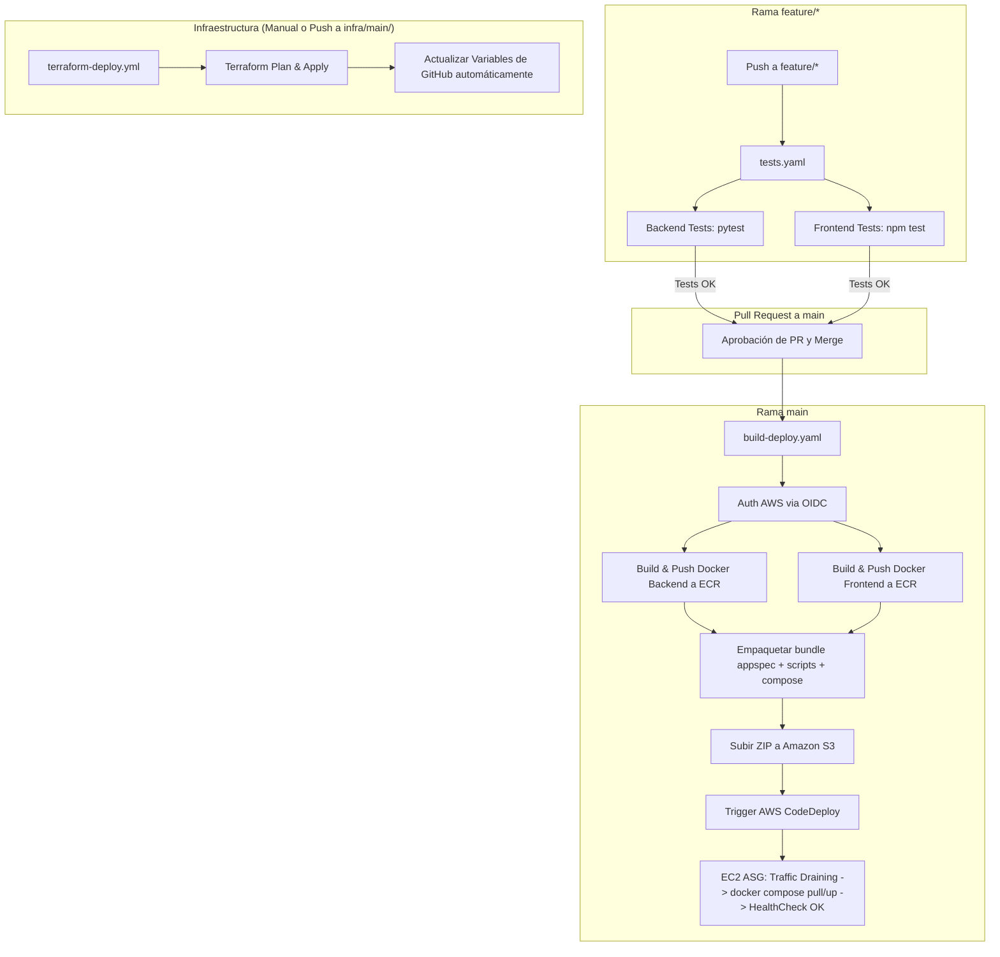

# Taller de DevOps con un Monorepositorio — AWS & Terraform

Este repositorio implementa un flujo integral de **DevOps** para el aprovisionamiento, integración continua, entrega continua (CI/CD) y despliegue automatizado de una aplicación *FullStack* (**Calculadora: React + FastAPI + Nginx**) en la nube de **Amazon Web Services (AWS)**.

Combina **Infraestructura como Código (IaC)** con **Terraform**, contenerización con **Docker / Docker Compose**, pipelines automatizados con **GitHub Actions** utilizando autenticación sin claves mediante **OpenID Connect (OIDC)**, registro de imágenes en **Amazon ECR**, artefactos en **Amazon S3**, y orquestación de despliegues controlados con **AWS CodeDeploy** sobre un **Auto Scaling Group (ASG)** detrás de un **Application Load Balancer (ALB)**.

---

## 🏗️ Arquitectura de la Solución


### Componentes de Infraestructura

1. **Red y Alta Disponibilidad (VPC Multi-AZ):**
   - VPC personalizada con Internet Gateway y subredes públicas distribuidas en múltiples zonas de disponibilidad (*Availability Zones*).
   - Application Load Balancer (**ALB**) público como punto de entrada único (puerto `80`), con comprobación de salud continua (*Health Checks*) hacia `/api/health`.

2. **Cómputo Escalable y Seguro (EC2 / ASG):**
   - **Auto Scaling Group (ASG)** administrado con Launch Template sobre *Amazon Linux 2023*.
   - Comprobaciones de estado delegadas al balanceador (`health_check_type = "ELB"`).
   - *Security Groups* con principio de menor privilegio: las instancias EC2 **solo** reciben tráfico HTTP proveniente del Security Group del ALB.
   - Administración remota y segura mediante **AWS Systems Manager (SSM)** sin necesidad de exponer puertos SSH (puerto `22`).

3. **Almacenamiento y Registro de Contenedores:**
   - **Amazon ECR**: Repositorios dedicados para backend (`calculadora/backend`) y frontend (`calculadora/frontend`) con escaneo de vulnerabilidades al hacer push (*scan on push*).
   - **Amazon S3**: Bucket con versionado y cifrado del lado del servidor (AES-256) para almacenar los paquetes de revisión (*bundles*) de CodeDeploy.

4. **Despliegue Continuo con Tráfico Controlado:**
   - **AWS CodeDeploy**: Aplicación y Deployment Group configurados con despliegue *In-Place* y control de tráfico (*Traffic Control* coordinado con el Target Group del ALB) y *Rollback* automático ante fallos.

5. **Seguridad y Autenticación CI/CD:**
   - Autenticación federada **OIDC (OpenID Connect)** entre GitHub Actions y AWS IAM, eliminando el uso de `AWS_ACCESS_KEY_ID` o credenciales estáticas de larga duración.

---

## 📁 Estructura del Monorepositorio

```text
.
├── .github/
│   └── workflows/
│       ├── ci-app.yml              # Pipeline CI: Pruebas de Backend (pytest), Frontend (Jest/build) y Docker
│       ├── ci-terraform.yml        # Pipeline CI: Terraform format, validate y plan en PRs
│       ├── cd-terraform-deploy.yml # Pipeline CD: Despliegue de Infraestructura + App, Health Check y Observabilidad
│       └── deploy-test-destroy.yml # Pipeline E2E: Despliegue completo, pruebas de carga ALB y destrucción automática
├── backend/                        # API REST en FastAPI (Python 3.9)
│   ├── app/
│   │   ├── core/                   # Configuración, logger estructurado, CORS, middleware y seguridad JWT
│   │   ├── routers/                # Endpoints: auth, calculadora y health
│   │   ├── schemas/                # Modelos de datos Pydantic
│   │   └── services/               # Lógica de negocio
│   ├── tests/                      # Pruebas automatizadas con pytest y httpx
│   ├── Dockerfile                  # Imagen basada en python:3.9-alpine con usuario no-root
│   ├── main.py                     # Punto de entrada de la aplicación
│   └── requirements.txt            # Dependencias Python
├── frontend/                       # Aplicación SPA en React (TypeScript)
│   ├── src/
│   │   ├── components/             # Componentes modulares (Display, NumberPad, OperationPad, etc.)
│   │   ├── hooks/                  # Custom hooks (useAuth, useCalculadora)
│   │   ├── services/               # Cliente HTTP / API service
│   │   └── *.test.tsx              # Pruebas automatizadas con Jest y React Testing Library
│   ├── nginx.conf.template         # Plantilla Nginx con reverse proxy /api/ hacia el backend
│   ├── Dockerfile                  # Multi-stage build (Node 18 builder + Nginx unprivileged runtime)
│   └── package.json                # Dependencias y scripts de React
├── infra/                          # Infraestructura como Código (Terraform)
│   ├── bootstrap/                  # Infraestructura inicial / remota (actualmente vacía)
│   └── main/                       # Infraestructura principal (VPC, ALB, ASG, CodeDeploy, etc.)
│       ├── main.tf                 # Definición de VPC, ALB, ASG, ECR, S3, IAM, CodeDeploy
│       ├── variables.tf            # Parámetros y variables de configuración
│       ├── outputs.tf              # Valores de salida (DNS del ALB, nombres de ECR, S3, etc.)
│       └── user_data.sh            # Script de aprovisionamiento de EC2 (Docker, Compose, CodeDeploy Agent)
├── scripts/                        # Scripts de ciclo de vida para CodeDeploy y despliegue local
│   ├── before_install.sh           # Hook CodeDeploy: Limpieza de /opt/mi-app
│   ├── after_install.sh            # Hook CodeDeploy: Permisos de ejecución
│   ├── start_app.sh                # Hook CodeDeploy: Login ECR, pull de imágenes y docker compose up
│   └── deploy_local.sh             # Script para compilar y desplegar a AWS desde tu terminal local
├── docs/                           # Guías paso a paso para laboratorios manuales
│   ├── iam.md                      # Configuración de roles y políticas IAM
│   ├── ecr.md                      # Creación y autenticación de repositorios ECR
│   ├── s3.md                       # Configuración de buckets S3 para CodeDeploy
│   ├── vpc.md                      # Creación de VPC, subredes, IGW y tablas de ruteo
│   ├── ec2.md                      # Creación y configuración de instancias EC2
│   ├── codedeploy.md               # Configuración de aplicaciones y grupos en CodeDeploy
│   └── cleanup.md                  # Procedimiento de limpieza y eliminación de recursos
├── appspec.yml                     # Especificación leída por el agente de AWS CodeDeploy
├── docker-compose.yml              # Orquestación de contenedores para producción
└── README.md
```

---

## 🔄 Flujos de Integración y Despliegue Continuo (CI/CD)

El repositorio incluye 3 flujos de trabajo en **GitHub Actions**:



### 1. `tests.yaml` — Pruebas en ramas de desarrollo
- **Activación:** Cada `push` a ramas que coincidan con `feature/*`.
- **Backend:** Configura Python 3.9, instala dependencias y ejecuta la suite de `pytest` sobre `backend/tests/`.
- **Frontend:** Configura Node.js 18, instala dependencias y ejecuta `npm test -- --watchAll=false` con Jest y React Testing Library.

### 2. `build-deploy.yaml` — Construcción y despliegue a AWS
- **Activación:** Cada `push` a la rama `main`.
- **Paso 1:** Se autentica en AWS usando el rol OIDC configurado en `AWS_ROLE_ARN`.
- **Paso 2 (`backend-build`):** Construye la imagen Docker del backend y la sube a Amazon ECR con los tags `latest` y `${GITHUB_SHA}`.
- **Paso 3 (`frontend-build`):** Construye la imagen Docker del frontend y la sube a Amazon ECR con los tags `latest` y `${GITHUB_SHA}`.
- **Paso 4 (`deploy`):** Empaqueta los archivos de despliegue (`appspec.yml`, `docker-compose.yml`, `scripts/`), los sube al bucket S3 y crea un despliegue en AWS CodeDeploy.

### 3. `terraform-deploy.yml` — Aprovisionamiento de Infraestructura
- **Activación:** `push` en rutas de infraestructura o ejecución manual vía `workflow_dispatch` (opciones: `plan`, `apply`, `destroy`).
- Realiza `terraform init`, `validate`, `plan`, `apply` y actualiza dinámicamente las variables del repositorio en GitHub mediante la API/CLI de GitHub.

### 4. `deploy-test-destroy.yml` — Ciclo Completo E2E (Despliegue, App, Pruebas ALB y Destrucción)
- **Activación:** Ejecución manual vía `workflow_dispatch` con parámetros configurables:
  - `wait_minutes`: Tiempo de espera tras las pruebas antes de destruir (por defecto: 5 minutos).
  - `auto_destroy`: Si debe destruir automáticamente la infraestructura (por defecto: `true`).
  - `test_requests`: Número de peticiones para la prueba de carga del ALB (por defecto: `200`).
  - `test_concurrency`: Nivel de concurrencia en las pruebas (por defecto: `10`).
- **Flujo:**
  1. Aprovisiona la infraestructura con Terraform (`terraform apply`).
  2. Espera a que las instancias del Auto Scaling Group estén en estado `InService` y el CodeDeploy Agent inicializado.
  3. Ejecuta el script de despliegue (`scripts/deploy_local.sh`), construyendo las imágenes Docker, subiéndolas a ECR, subiendo el bundle a S3 y disparando el despliegue con AWS CodeDeploy.
  4. Espera a que el Application Load Balancer esté saludable (`/api/health` responda HTTP 200).
  5. Ejecuta las pruebas de carga y balanceo con `scripts/test_alb.sh`, publicando el reporte en `$GITHUB_STEP_SUMMARY` y subiéndolo como artefacto.
  6. Realiza una pausa programada (tiempo de espera) permitiendo interactuar con el entorno en vivo.
  7. Destruye de forma segura y automatizada toda la infraestructura (`terraform destroy`), vaciando previamente buckets S3 y repositorios ECR.

---

## 📦 Orquestación de Despliegue con CodeDeploy

El agente de CodeDeploy en cada instancia del ASG lee `appspec.yml` y ejecuta los hooks del ciclo de vida:

```yaml
version: 0.0
os: linux
files:
  - source: /
    destination: /opt/mi-app

hooks:
  BeforeInstall:
    - location: scripts/before_install.sh
      timeout: 60
      runas: root
  AfterInstall:
    - location: scripts/after_install.sh
      timeout: 60
      runas: root
  ApplicationStart:
    - location: scripts/start_app.sh
      timeout: 300
      runas: root
```

### Scripts de ciclo de vida:
- **`scripts/before_install.sh`**: Prepara el directorio de despliegue `/opt/mi-app`.
- **`scripts/after_install.sh`**: Asegura permisos de ejecución (`chmod +x`) sobre los scripts.
- **`scripts/start_app.sh`**:
  1. Detecta automáticamente la región y cuenta de AWS vía **IMDSv2** y **AWS STS**.
  2. Autentica el daemon de Docker contra Amazon ECR usando el rol IAM asignado a la instancia EC2.
  3. Ejecuta `docker compose pull` para descargar las imágenes más recientes.
  4. Realiza el recambio ordenado con `docker compose down` y `docker compose up -d`.
  5. Ejecuta `docker image prune -f` para evitar la saturación de disco.

---

## 🚀 Guías de Ejecución y Uso

### Opción A: Desarrollo Local (Sin AWS)

#### 1. Backend (FastAPI)
```bash
cd backend
python -m venv venv
source venv/bin/activate   # En Windows: venv\Scripts\activate
pip install -r requirements.txt
uvicorn main:app --reload --port 8000
```
- API Docs interactiva: [http://localhost:8000/docs](http://localhost:8000/docs)
- Health check: [http://localhost:8000/api/health](http://localhost:8000/api/health)
- Ejecutar tests: `pytest tests/`

#### 2. Frontend (React)
```bash
cd frontend
npm install
npm start
```
- Aplicación: [http://localhost:3000](http://localhost:3000)
- Ejecutar tests: `npm test`

---

### Opción B: Aprovisionamiento de Infraestructura con Terraform

#### Prerrequisitos:
- [AWS CLI v2](https://aws.amazon.com/cli/) instalada y configurada (`aws configure`).
- [Terraform](https://www.terraform.io/) (versión >= 1.0) instalado.

#### Pasos:
```bash
cd infra/main

# Inicializar proveedores y módulos
terraform init

# Validar sintaxis y configuración
terraform validate

# Ver el plan de ejecución
terraform plan

# Aplicar y crear toda la infraestructura
terraform apply
```

Al finalizar, Terraform mostrará los *outputs* clave, incluyendo el DNS público del balanceador (`alb_dns_name`).

---

### Opción C: Despliegue Directo desde CLI Local (`deploy_local.sh`)

Si ya aplicaste la infraestructura con Terraform y deseas compilar y desplegar directamente desde tu máquina local sin esperar a GitHub Actions:

```bash
# Asegúrate de tener permisos de ejecución
chmod +x scripts/deploy_local.sh

# Ejecutar el despliegue
./scripts/deploy_local.sh
```

El script leerá automáticamente los outputs de Terraform en `infra/main/`, autenticará Docker en ECR, construirá y subirá las imágenes, subirá el paquete a S3 y disparará el despliegue en CodeDeploy monitoreando su progreso.

---

### Opción D: Despliegue Automatizado con GitHub Actions

1. En tu repositorio de GitHub, ve a **Settings → Secrets and variables → Actions**.
2. En la pestaña **Variables**, define las siguientes variables (si no usas el workflow automatizado de Terraform):

| Nombre de Variable | Descripción | Ejemplo de Valor |
| :--- | :--- | :--- |
| `AWS_REGION` | Región de AWS donde reside la infraestructura | `us-east-1` |
| `AWS_ROLE_ARN` | ARN del Rol IAM configurado con Trust Policy OIDC para GitHub | `arn:aws:iam::123456789012:role/GitHubActionsDeployRole` |
| `BACKEND_ECR_REGISTRY` | URL del repositorio ECR del backend | `123456789012.dkr.ecr.us-east-1.amazonaws.com/calculadora/backend` |
| `FRONTEND_ECR_REGISTRY`| URL del repositorio ECR del frontend | `123456789012.dkr.ecr.us-east-1.amazonaws.com/calculadora/frontend` |
| `S3_BUCKET` | Nombre del bucket S3 para revisiones de CodeDeploy | `calculadora-codedeploy-bucket-xxxx` |
| `CODEDEPLOY_APP` | Nombre de la aplicación en CodeDeploy | `calculadora-codedeploy-app` |
| `CODEDEPLOY_GROUP` | Nombre del grupo de despliegue en CodeDeploy | `calculadora-deployment-group` |

3. Realiza tus cambios en una rama `feature/nueva-funcionalidad`, haz push y abre un Pull Request hacia `main`.
4. Una vez integrados los cambios en `main`, el workflow `build-deploy.yaml` realizará el despliegue automáticamente.

---

## 📚 Laboratorios y Guías Manuales (Docs)

Si deseas realizar o estudiar cada paso de forma manual a través de la consola de AWS o AWS CLI, consulta las guías dedicadas en el directorio [`docs/`](./docs/):

1. 🔐 [Configuración de IAM y OIDC](./docs/iam.md)
2. 🐳 [Configuración de Repositorios ECR](./docs/ecr.md)
3. 🪣 [Configuración de Bucket S3](./docs/s3.md)
4. 🌐 [Configuración de Red y VPC](./docs/vpc.md)
5. 🖥️ [Configuración de Instancia EC2](./docs/ec2.md)
6. 🚀 [Configuración de AWS CodeDeploy](./docs/codedeploy.md)
7. 🧹 [Limpieza y Eliminación de Recursos](./docs/cleanup.md)

---

## 🧹 Limpieza y Destrucción de Recursos

Para evitar cargos innecesarios en tu cuenta de AWS una vez concluido el taller o las pruebas:

```bash
cd infra/main
terraform destroy -auto-approve
```

O consulta la [Guía de Limpieza Manual](./docs/cleanup.md) si creaste recursos a través de la consola o AWS CLI.